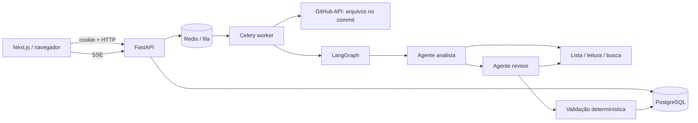

# RepoLens

**Menos ruído. Mais clareza.** Aplicação full stack para revisão de repositórios públicos JavaScript/TypeScript, com agentes de IA e evidências verificáveis.

Next.js 16 · React 19 · TypeScript · FastAPI · PostgreSQL · Celery · Redis · LangGraph · OpenAI

## Executar

Requisitos: Docker Desktop com Compose e portas 3000/8000 livres.

```bash
# Na primeira execução:
cp .env.example .env
# Edite SESSION_SECRET: use uma chave aleatória com pelo menos 32 caracteres.
# Gerar no Windows: py -c "import secrets; print(secrets.token_hex(32))"
docker compose up --build -d
```

PowerShell: use `Copy-Item .env.example .env` no lugar de `cp`.

- Aplicação: http://localhost:3000
- Swagger/OpenAPI: http://localhost:8000/docs
- Saúde: http://localhost:8000/health

Clique em **Explorar demonstração**, depois em **Nova análise**. Uma URL como `https://github.com/example/project` é suficiente no modo demo.

**Modo demo não analisa o repositório informado:** usa três arquivos fictícios e resultados determinísticos. Nenhuma chamada à IA ou ao GitHub. O aviso aparece no dashboard, formulário, relatório e exportação. Cada visitante recebe uma sessão isolada.

```bash
docker compose logs -f api worker
docker compose down                  # preserva dados
# docker compose down -v              # ATENÇÃO: apaga o banco
```

## Ativar agentes reais e login GitHub

1. Crie um OAuth App em GitHub → Settings → Developer settings → OAuth Apps.
2. Homepage: `http://localhost:3000`.
3. Authorization callback: `http://localhost:8000/auth/github/callback`.
4. Configure `.env`:

```dotenv
ANALYSIS_MODE=live
ALLOW_DEMO_LOGIN=false
OPENAI_API_KEY=sua-chave
OPENAI_MODEL=gpt-4.1-mini
GITHUB_CLIENT_ID=seu-client-id
GITHUB_CLIENT_SECRET=seu-client-secret
# Opcional: token com acesso somente de leitura, para ampliar quota da API GitHub
GITHUB_TOKEN=
```

5. Recrie API e worker: `docker compose up -d --force-recreate api worker`.
6. Entre com GitHub e use um repositório público pequeno com fontes JS/TS.

**Há custo de API no modo live.** A aplicação registra tokens de entrada/saída, modelo, ferramentas e duração; não exibe valor monetário estimado, pois preços variam. Código selecionado será enviado ao provedor de IA. Não envie código sensível. Tokens OAuth são usados apenas para obter a identidade e não são persistidos. O token de leitura do servidor, quando configurado, é independente do login.

## Funcionalidades

- Dashboard com busca e histórico pessoal (até 100 análises mais recentes).
- Login GitHub OAuth com validação de state e cookie HttpOnly assinado.
- Login demo separado, somente quando explicitamente habilitado e em modo demo.
- Criação de análises com foco em qualidade, arquitetura ou testes.
- Processamento em worker Celery; estados queued/running/completed/failed.
- Progresso por SSE, eventos persistidos e reconexão com cursor.
- Relatório com filtros por impacto/resolução e busca textual.
- Marcação de itens resolvidos e exportação Markdown.
- Links para arquivos/linhas no SHA imutável analisado.
- Dois agentes reais com ferramentas e orquestração LangGraph.
- Validação determinística de arquivo, intervalo e trecho de evidência.
- Migrações Alembic, testes automatizados e workflow de CI.
- Interface responsiva em português, sem dependência de serviço de UI.

## Arquitetura



### Por que dois agentes?

O **analista** escolhe ferramentas para investigar o código. O **revisor** recebe somente os achados com evidência textual válida, consulta o código por ferramentas e remove ou ajusta conclusões. O fluxo entre eles é determinístico; não há coordenador autônomo artificial. Conteúdo do repositório nunca vira código executável.

Ferramentas operam apenas sobre um dicionário de arquivos obtidos pela API do GitHub: `list_files`, `read_file` (até 120 linhas por chamada) e `search_code` (busca literal, até 40 ocorrências). Não existe shell para os agentes. O revisor final também passa pela validação textual e deduplicação por intervalo.

### Dados

- `users`: identidade GitHub ou visitante demo.
- `analyses`: usuário, repositório, foco, modo, commit, status, resumo e métricas.
- `findings`: achados com evidência, recomendação e estado de resolução.
- `analysis_events`: sequência de progresso por análise.

Os arquivos completos são transitórios na memória do worker; apenas evidências dos achados são persistidas.

## Estrutura

```text
backend/
  app/
    main.py          # API, autorização por recurso, SSE e exportação
    auth.py          # OAuth, sessão e modo demo
    repository.py    # integração GitHub e ferramentas restritas
    agents.py        # grafo analista → revisor + validação
    tasks.py         # processamento Celery
    models.py        # modelos SQLAlchemy
    schemas.py       # contratos Pydantic
  migrations/        # Alembic
  tests/             # API, isolamento, ferramentas e agentes com LLM mockado
frontend/
  app/page.tsx                  # dashboard e criação
  app/analyses/[id]/page.tsx     # relatório e SSE
  components/shell.tsx          # navegação
compose.yaml
smoke.py                        # teste integrado contra os serviços reais
```

## Testes

Python 3.13 e Node.js 22+ para desenvolvimento local.

```bash
cd backend
py -m venv .venv
# Windows:
.venv/Scripts/python.exe -m pip install -r requirements.txt
.venv/Scripts/python.exe -m pytest -q
.venv/Scripts/python.exe -m ruff check app tests migrations
# Linux/macOS: substitua .venv/Scripts/python.exe por .venv/bin/python

cd ../frontend
npm ci
npm run typecheck
npm run build
npm audit

# Na raiz, com Docker Compose rodando em modo demo:
py smoke.py
```

Os testes unitários/integração da API usam SQLite temporário e fila mockada. O teste do grafo usa respostas OpenAI mockadas e comprova uso de ferramentas nos dois agentes. `smoke.py` usa PostgreSQL, Redis, Celery, SSE e frontend reais do Compose. Não faz chamadas de IA pagas.

Para desenvolvimento da interface: mantenha os serviços Docker de backend e execute `docker compose stop web`, `cd frontend`, `npm ci`, `npm run dev`. Não altere o host para `127.0.0.1` se as URLs configuradas usam `localhost`: cookies e verificação de origem precisam ser consistentes.

## Limites e segurança

- Somente URLs HTTPS exatas `github.com/owner/repo`, sem query/fragmento; chamadas externas fixadas na API GitHub, sem redirects.
- Repositórios privados rejeitados, mesmo com token de servidor autorizado.
- Até 60 arquivos/300 KB no padrão, arquivos individuais até 40 KB, sem symlinks; dependências, artefatos e lockfiles excluídos. Escopo parcial é sinalizado.
- 10 etapas de ferramentas por agente + conclusão, até 8 chamadas por etapa e saída limitada. Requisições têm timeout; worker tem limite rígido de 360 segundos.
- Uma análise ativa e no máximo 10 criações por hora por usuário. Demo cria identidades descartáveis: **não é um mecanismo antiabuso global**.
- Cookies HttpOnly/SameSite=Lax; mutações exigem Origin exato. Clientes de API devem enviar `Origin: http://localhost:3000` no ambiente padrão.
- API verifica propriedade em detalhes, eventos, exportação e atualização de achados.
- Conteúdo é tratado como não confiável no prompt e renderizado como texto React (sem HTML ou Markdown arbitrário).
- Correspondência textual de evidência **não comprova a validade semântica** do achado. Prompt injection não é um problema resolvido apenas com instruções: ferramentas restritas reduzem o impacto, não garantem conclusões confiáveis.
- Sem execução de scripts, instalação de dependências, criação de issues/PRs ou escrita no repositório.

### Antes de expor publicamente

Este é um MVP de portfólio, não uma auditoria garantida ou serviço endurecido para produção. Configure HTTPS, `COOKIE_SECURE=true`, URLs públicas corretas, credenciais próprias do PostgreSQL, backup e secrets gerenciados. Desative login demo. Prefira frontend/API no mesmo site; hosts em sites distintos exigem revisão de cookies/CSRF.

No Compose, portas são expostas apenas no loopback; PostgreSQL e Redis não são publicados. Use reverse proxy com TLS e sem buffering na rota SSE. `NEXT_PUBLIC_API_URL` é variável de build: para publicação, configure `build.args.NEXT_PUBLIC_API_URL` no serviço web e refaça o build.

Trabalhos interrompidos por queda do worker ou limite rígido podem permanecer `running`: reconciliação de jobs, outbox transacional para publicação na fila, cancelamento e limpeza de sessões demo são melhorias futuras. SSE lê eventos do banco a cada dois segundos; funciona no MVP, mas demanda fan-out dedicado em grande escala. Métricas do dashboard consideram apenas o histórico carregado. Ainda não há avaliação quantitativa de precisão/recall nem teste de navegador automatizado.

## Para apresentar no portfólio

Demonstre: login → criar análise → eventos → evidência → marcar resolvido → exportar. Explique a separação HTTP/worker, autorização por recurso, SHA imutável e por que evidência textual não equivale a conclusão correta. Grave também uma execução live e documente erros reais encontrados, rejeições do revisor e custo observado. Nunca apresente resultados demo como achados de um repositório real.
